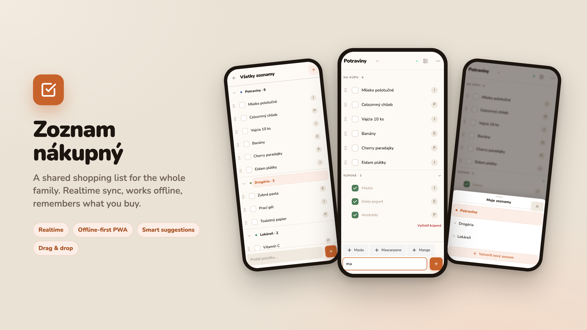
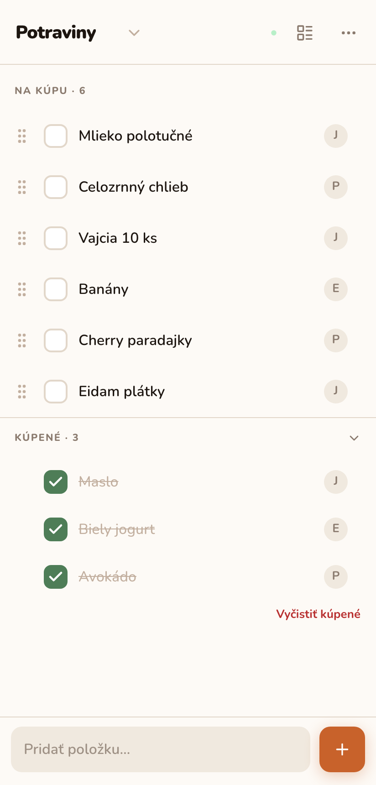
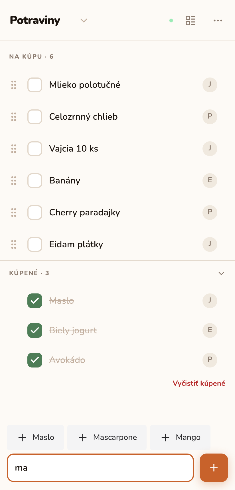
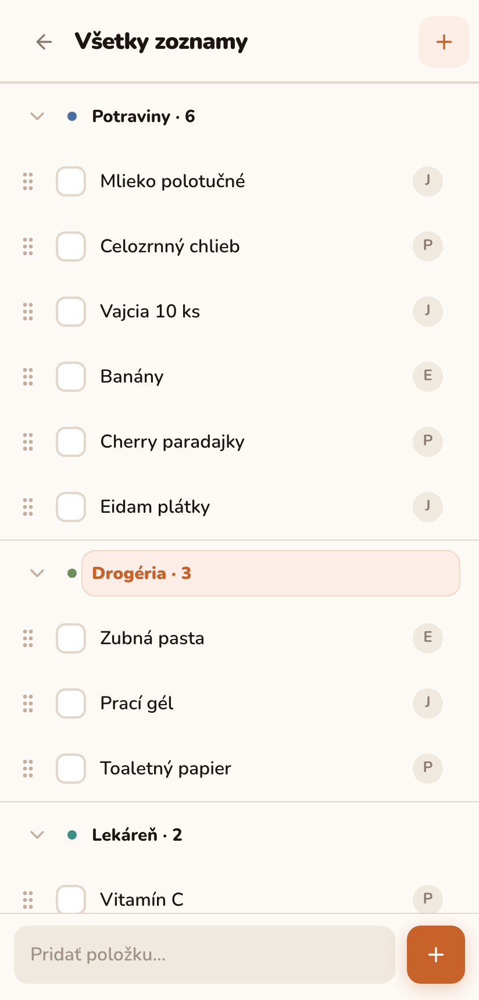
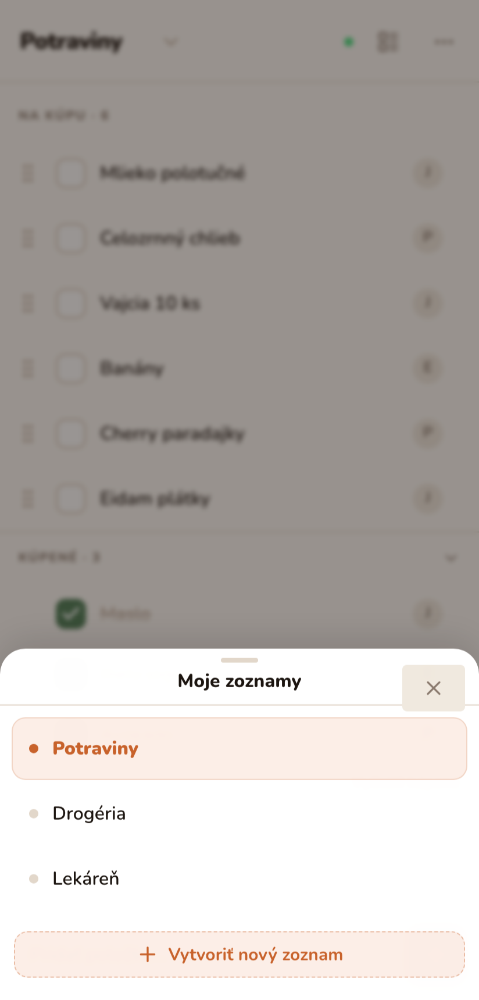
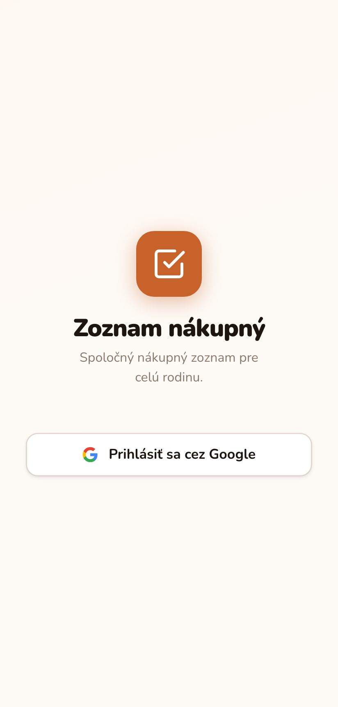

<p align="center">
  
</p>

# Zoznam nákupný

A mobile-first web app for a family's shared shopping lists. Members sign in with Google, join the family with an invite code, and every change syncs to everyone in real time. Built with Vite, React 19, TypeScript and Chakra UI on Firebase (Auth, Firestore, Hosting). The UI is in Slovak.

## Features

- **Shared lists, live.** Every family member sees every list, and items appear, move and get checked off on all devices at once.
- **Works offline.** It is an installable PWA with Firestore's persistent cache, so you can keep checking items off in a store with no signal. Changes sync when you're back online.
- **Purchase Memory.** The app remembers what the family buys and how often. Typing two letters suggests the most likely item, ranked by the list you're adding to. Clearing the purchased section doesn't lose the suggestions.
- **All Lists view.** Every list on one screen, with drag and drop between lists and a single add-item bar that targets the list you pick.
- **Mobile-first details.** Swipe to reveal actions, drag to reorder, tap a row to check it off, and each item shows who added it.

| Shopping list | Suggestions | All Lists | List switcher | Sign-in |
| :---: | :---: | :---: | :---: | :---: |
|  |  |  |  |  |

The screenshots use demo data in the local Firebase emulators.

## Documentation

- [`CONTEXT.md`](./CONTEXT.md): the domain glossary (Family, Member, List, Add Target, Purchase Memory, ...)
- [`docs/adr/`](./docs/adr): architecture decisions and the alternatives they rejected
- [`docs/conventions.md`](./docs/conventions.md): code structure and layering rules (in Slovak)
- [`PLAN.md`](./PLAN.md): the original implementation plan (in Slovak)

## Prerequisites

- **Node.js 24**, pinned in `.nvmrc` (`nvm use`) and required by `engines` in `package.json`.
- **JDK 21+** for anything that starts the Firebase emulators (`test:rules`, `test:integration`, `test:emulators`, and e2e tests with a signed-in member). Without it, `firebase emulators:exec` fails.
- **Firebase CLI**, either installed globally (`npm install -g firebase-tools`) or through `npx firebase <command>`. `firebase-tools` is in `devDependencies`, so `npx firebase` works right after `npm install`.

## Firebase project setup

1. Create a project in the [Firebase Console](https://console.firebase.google.com/).
2. Under **Authentication**, enable **Google** as a sign-in provider.
3. Under **Firestore Database**, create a database. Production or test mode doesn't matter, because access is defined by `firestore.rules`.
4. In the project settings, register a **Web App** and copy its config values (`apiKey`, `authDomain`, `projectId`, `storageBucket`, `messagingSenderId`, `appId`). They go into `.env`.
5. Point the CLI at your project with `firebase use --add`, or edit `.firebaserc` directly.

## Environment variables

Copy `.env.example` to `.env` and fill in the values from the Firebase Console:

```bash
cp .env.example .env
```

```
VITE_FIREBASE_API_KEY=
VITE_FIREBASE_AUTH_DOMAIN=
VITE_FIREBASE_PROJECT_ID=
VITE_FIREBASE_STORAGE_BUCKET=
VITE_FIREBASE_MESSAGING_SENDER_ID=
VITE_FIREBASE_APP_ID=
VITE_USE_FIREBASE_EMULATOR=false
```

`VITE_USE_FIREBASE_EMULATOR=true` points the app at the local Auth and Firestore emulators, so local development never touches production data. `false` uses the real Firebase backend from the other `VITE_FIREBASE_*` values.

## Invite code (seed script)

The app never generates invite codes in the UI. A one-time script creates one:

```bash
npm run seed
```

`scripts/seed.ts`:

- connects to the Firestore emulator at `127.0.0.1:8080` (it sets `FIRESTORE_EMULATOR_HOST` itself if unset), so the emulator must already be running (`firebase emulators:start` or inside `emulators:exec`),
- initializes the Firebase Admin SDK with the hard-coded `projectId: 'zoznam-nakupny-dev'`,
- generates a random 32-character hex invite code,
- creates or merges `families/{FAMILY_ID}` and creates `invites/{inviteCode}` pointing at that family,
- prints the invite code, which a new member enters in the app when joining.

To use it against a real project, change `projectId` in the script to your project ID and provide Admin SDK credentials (for example `GOOGLE_APPLICATION_CREDENTIALS`).

## Purchase Memory back-fill (one-time)

The Purchase Memory (`families/{FAMILY_ID}/purchaseMemory`, see [ADR 0004](./docs/adr/0004-purchase-memory-catalog.md)) is written every time an item is checked off. A script copies the existing purchased items into it once:

```bash
npm run migrate:purchase-memory                                               # Firestore emulator (127.0.0.1:8080)
GCLOUD_PROJECT=<project-id> npm run migrate:purchase-memory -- --production   # real project, needs Admin SDK credentials (e.g. GOOGLE_APPLICATION_CREDENTIALS)
```

For each normalized item name it sets the purchase count (total and per list), the last purchase time (the newest `completedAt`) and the text (from the newest item). It sets values instead of adding to them, so running it again gives the same result. It does, however, overwrite anything counted by check-offs in the meantime.

Deploy in this order: `firebase deploy --only firestore:rules`, then the script, then hosting. A member still on the old PWA version (until they tap "Obnoviť") checks items off without writing to the Purchase Memory. If that happens, run the script again before anyone clears the purchased section; those check-offs are still among the purchased items and will be counted.

## Development

```bash
npm run dev
```

Starts the Vite dev server at `http://localhost:5173`.

## Tests

- **`npm run check`** is the single quality gate: lint, circular-import check, Prettier check, unit tests and the production build (which typechecks). This is what CI runs first.
- **`npm run test`** runs the Vitest unit tests. No emulator needed.
- **`npm run test:rules`** and **`npm run test:integration`** need JDK 21+. You don't start the emulators by hand: both commands wrap themselves in `firebase emulators:exec`, which starts the emulators, waits until they're ready, runs the tests and shuts them down. **`npm run test:emulators`** runs both suites inside one emulator session, as CI does.
- **`npm run test:e2e`** runs the Playwright tests. Unlike the commands above, it is **not** wrapped in `emulators:exec`. `playwright.config.ts` starts its own dev server (`npm run dev`) as its `webServer`, but tests that need a signed-in member (`e2e/mobile-smoke.spec.ts`, `e2e/offline-sync.spec.ts`) also need the Auth and Firestore emulators running. The recommended way to run the whole e2e suite is:

  ```bash
  firebase emulators:exec --only firestore,auth "npm run test:e2e"
  ```

  Unauthenticated tests such as `e2e/smoke.spec.ts` work without the emulators, because they never touch Auth or Firestore.

## Build

```bash
npm run build
```

Typechecks (`tsc -b`) and builds the production bundle into `dist/`.

## PWA

The app is an installable PWA (`vite-plugin-pwa`, configured in `vite.config.ts`): a web manifest plus a Workbox service worker that precaches the app shell, so the app opens offline while Firestore's persistent cache holds the data. The service worker is generated only in production builds; try it locally with `npm run build && npm run preview`. A new version never activates on its own: the app shows a "new version available" toast with an "Obnoviť" (reload) button.

The icons in `public/` (`pwa-*.png`, `maskable-icon-512x512.png`, `apple-touch-icon-180x180.png`, `favicon.ico`) are generated from `public/logo.svg` and committed. After changing the logo, regenerate them with `npx pwa-assets-generator` (configured in `pwa-assets.config.ts`).

## Deploy

```bash
npm run build
firebase deploy
```

(or `npx firebase deploy` if `firebase-tools` isn't installed globally)

`firebase.json` sets `hosting.public` to `dist`, which is Vite's default build output (`vite.config.ts` sets no custom `build.outDir`).

Before `firebase deploy` works you need to:

1. **`firebase login`**: sign in interactively with your Google account. Nothing in this repository can automate this step.
2. Have `.firebaserc` (or `firebase use <project-id>`) point at the Firebase project you want to deploy to.

`firebase deploy` without `--only` deploys Hosting (the build from `dist/`), the Firestore rules (`firestore.rules`) and the Firestore indexes (`firestore.indexes.json`).

## License

[MIT](./LICENSE) © 2026 Filip Messa
